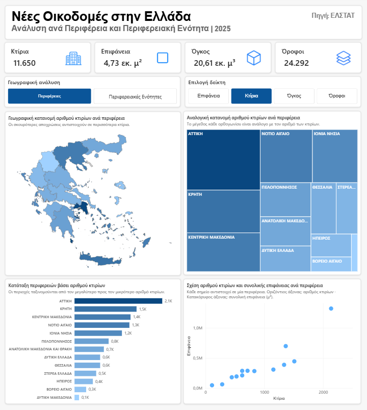
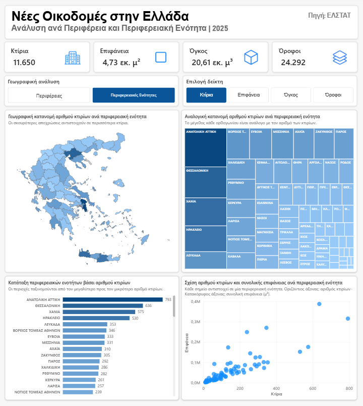
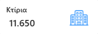
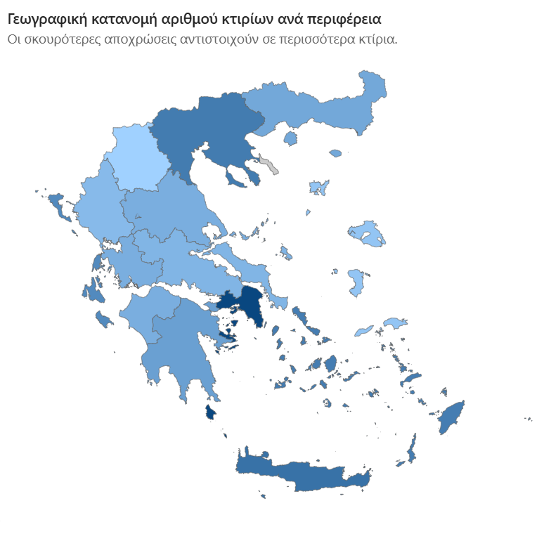
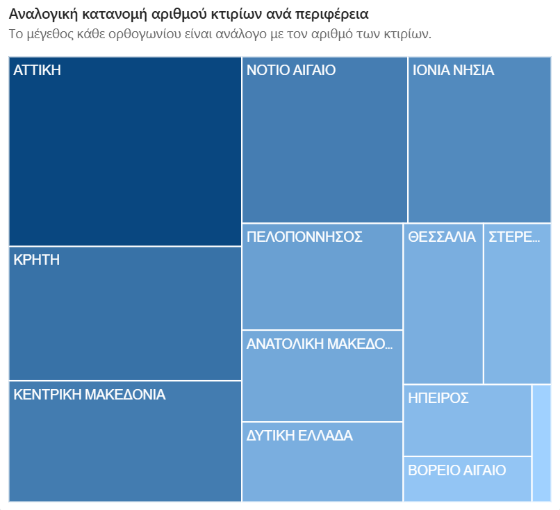
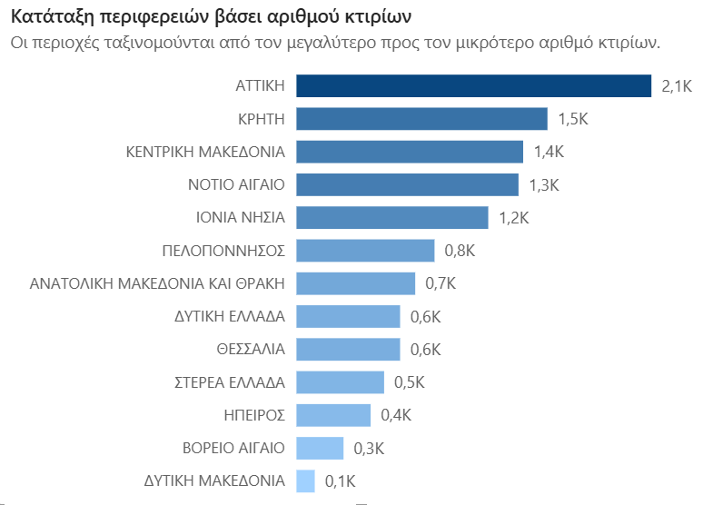
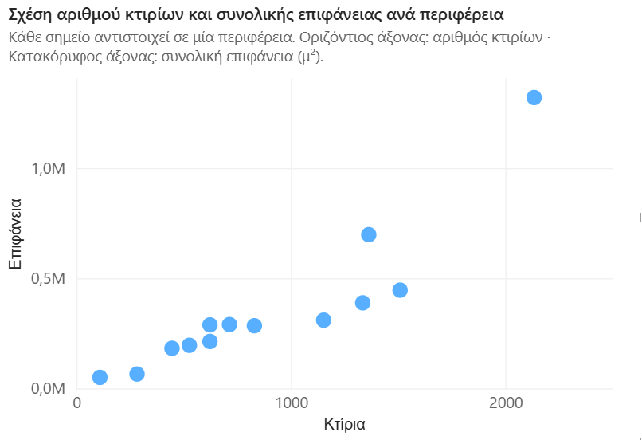
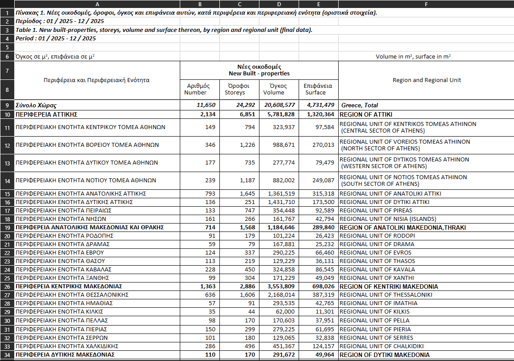
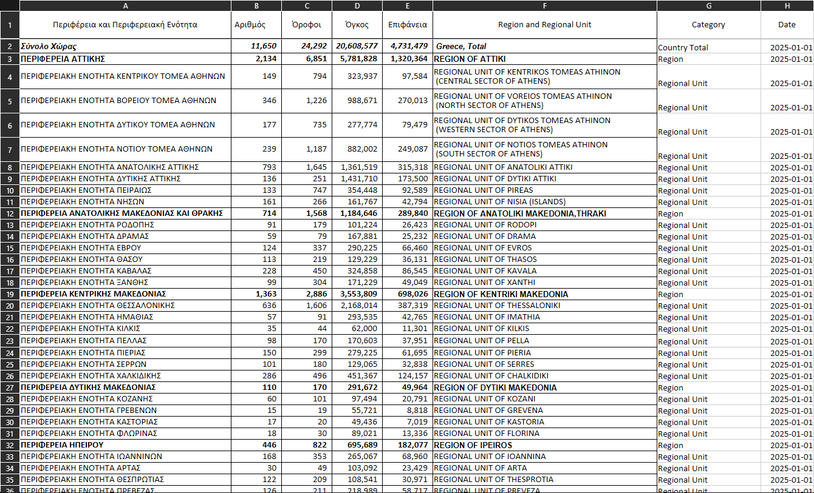

# Ανάλυση Νέας Οικοδομικής Δραστηριότητας στην Ελλάδα

**Γλώσσα τεκμηρίωσης:** 🇬🇧 [English](README.md) | 🇬🇷 **Ελληνικά**

---

## Επισκόπηση

Ένας **διαδραστικός πίνακας ελέγχου στο Power BI** για τη νέα οικοδομική δραστηριότητα στην Ελλάδα το **2025**, με βάση δημόσια διαθέσιμα στοιχεία της **Ελληνικής Στατιστικής Αρχής (ΕΛΣΤΑΤ)**.

Στο έργο αυτό, οι αρχικοί πίνακες Excel της ΕΛΣΤΑΤ καθαρίζονται και οργανώνονται ώστε να μπορούν να χρησιμοποιηθούν για ανάλυση. Ο πίνακας ελέγχου επιτρέπει τη σύγκριση της οικοδομικής δραστηριότητας σε δύο γεωγραφικά επίπεδα: **περιφέρειες** και **περιφερειακές ενότητες**. Η τρέχουσα έκδοση καλύπτει την περίοδο **Ιανουάριος–Δεκέμβριος 2025**. Επόμενος βασικός στόχος είναι η επέκταση της ανάλυσης σε περισσότερα έτη και μήνες.

---

## Περιεχόμενα

- [Επισκόπηση](#επισκόπηση)
- [Προεπισκοπήσεις του πίνακα ελέγχου](#προεπισκοπήσεις-του-πίνακα-ελέγχου)
- [Παρουσίαση του έργου](#παρουσίαση-του-έργου)
- [Βασικά ευρήματα](#βασικά-ευρήματα)
  - [Περιφέρειες](#περιφέρειες)
  - [Περιφερειακές ενότητες](#περιφερειακές-ενότητες)
- [Λειτουργίες του πίνακα ελέγχου](#λειτουργίες-του-πίνακα-ελέγχου)
  - [Γραφήματα και διαδραστικά στοιχεία](#γραφήματα-και-διαδραστικά-στοιχεία)
  - [Δυναμικοί τίτλοι και υπότιτλοι](#δυναμικοί-τίτλοι-και-υπότιτλοι)
- [Πηγή δεδομένων](#πηγή-δεδομένων)
- [Καθαρισμός και προετοιμασία δεδομένων](#καθαρισμός-και-προετοιμασία-δεδομένων)
  - [Πριν και μετά τον καθαρισμό](#πριν-και-μετά-τον-καθαρισμό)
- [Εργαλεία και τεχνικές](#εργαλεία-και-τεχνικές)
- [Δομή Έργου](#δομή-έργου)
- [Επόμενα βήματα](#επόμενα-βήματα)
- [Κατάσταση του έργου](#κατάσταση-του-έργου)

---

## Προεπισκοπήσεις του πίνακα ελέγχου

Ο πίνακας ελέγχου είναι στα ελληνικά, ώστε οι ονομασίες των γεωγραφικών περιοχών να εμφανίζονται με τον τρόπο που χρησιμοποιούνται στην Ελλάδα. **Πατήστε σε οποιαδήποτε εικόνα για να τη δείτε σε πλήρες μέγεθος.**

<table>
  <tr>
    <th align="center" width="50%">Περιφέρειες</th>
    <th align="center" width="50%">Περιφερειακές ενότητες</th>
  </tr>
  <tr>
    <td align="center" valign="middle">
      <a href="assets/greece-construction-analysis-regions-dashboard-v1.png">
        
      </a>
    </td>
    <td align="center" valign="middle">
      <a href="assets/greece-construction-analysis-regional_units-dashboard-v1.png">
        
      </a>
    </td>
  </tr>
  <tr>
    <td align="center"><sub>Σύγκριση της οικοδομικής δραστηριότητας ανά περιφέρεια</sub></td>
    <td align="center"><sub>Πιο αναλυτική σύγκριση ανά περιφερειακή ενότητα</sub></td>
  </tr>
</table>

---

## Παρουσίαση του έργου

Η ανάλυση βασίζεται σε τέσσερα βασικά μεγέθη της νέας οικοδομικής δραστηριότητας:

| Δείκτης | Σύνολο Ελλάδας, 2025 |
| --- | ---: |
| **Κτίρια** | **11.650** |
| **Όροφοι** | **24.292** |
| **Συνολικός όγκος κτιρίων** | **20.608.577 μ³** |
| **Συνολική επιφάνεια κτιρίων** | **4.731.479 μ²** |

Τα στοιχεία αφορούν **ολόκληρο το 2025** και δεν αποτελούν μηνιαία χρονοσειρά. Στις γεωγραφικές συγκρίσεις χρησιμοποιείται κάθε φορά το κατάλληλο επίπεδο ανάλυσης, ώστε να μην προσμετρώνται δύο φορές οι ίδιες κατασκευές από τα σύνολα των περιφερειών και των περιφερειακών ενοτήτων.

---

## Βασικά ευρήματα

**Η Αττική βρίσκεται στην πρώτη θέση και στους τέσσερις δείκτες** σε επίπεδο περιφέρειας. Συγκεντρώνει περίπου το **18,3% των νέων κτιρίων**, το **27,9% της συνολικής επιφάνειας**, το **28,1% του συνολικού όγκου** και το **28,2% των ορόφων** σε όλη τη χώρα. Σε επίπεδο περιφερειακής ενότητας, **η Ανατολική Αττική** καταγράφει τα περισσότερα κτίρια και τους περισσότερους ορόφους, ενώ **η Θεσσαλονίκη** προηγείται σε επιφάνεια και όγκο.

Οι πίνακες παρουσιάζουν τις τρεις υψηλότερες και τις τρεις χαμηλότερες τιμές για κάθε δείκτη το 2025. Πρόκειται για **απόλυτα μεγέθη**, όχι για δείκτες προσαρμοσμένους στον πληθυσμό κάθε περιοχής.

### Περιφέρειες

| Δείκτης | 3 υψηλότερες τιμές | 3 χαμηλότερες τιμές |
| --- | --- | --- |
| **Κτίρια** | 1. Αττική (**2.134**)<br>2. Κρήτη (**1.509**)<br>3. Κεντρική Μακεδονία (**1.363**) | 1. Δυτική Μακεδονία (**110**)<br>2. Βόρειο Αιγαίο (**283**)<br>3. Ήπειρος (**446**) |
| **Επιφάνεια (μ²)** | 1. Αττική (**1.320.364**)<br>2. Κεντρική Μακεδονία (**698.026**)<br>3. Κρήτη (**446.073**) | 1. Δυτική Μακεδονία (**49.964**)<br>2. Βόρειο Αιγαίο (**65.194**)<br>3. Ήπειρος (**182.077**) |
| **Όγκος κτιρίων (μ³)** | 1. Αττική (**5.781.828**)<br>2. Κεντρική Μακεδονία (**3.553.809**)<br>3. Κρήτη (**1.673.408**) | 1. Βόρειο Αιγαίο (**235.244**)<br>2. Δυτική Μακεδονία (**291.672**)<br>3. Ήπειρος (**695.689**) |
| **Όροφοι** | 1. Αττική (**6.851**)<br>2. Κεντρική Μακεδονία (**2.886**)<br>3. Κρήτη (**2.656**) | 1. Δυτική Μακεδονία (**170**)<br>2. Βόρειο Αιγαίο (**462**)<br>3. Ήπειρος (**822**) |

### Περιφερειακές ενότητες

| Δείκτης | 3 υψηλότερες τιμές | 3 χαμηλότερες τιμές |
| --- | --- | --- |
| **Κτίρια** | 1. Ανατολική Αττική (**793**)<br>2. Θεσσαλονίκη (**636**)<br>3. Χανιά (**520**) | 1. Ιθάκη (**11**)<br>2. Ευρυτανία (**11**)<br>3. Ικαρία (**15**) |
| **Επιφάνεια (μ²)** | 1. Θεσσαλονίκη (**387.319**)<br>2. Ανατολική Αττική (**315.318**)<br>3. Βόρειος Τομέας Αθηνών (**270.013**) | 1. Ευρυτανία (**2.113**)<br>2. Ιθάκη (**2.264**)<br>3. Κάρπαθος (**3.150**) |
| **Όγκος κτιρίων (μ³)** | 1. Θεσσαλονίκη (**2.168.014**)<br>2. Δυτική Αττική (**1.431.710**)<br>3. Ανατολική Αττική (**1.361.519**) | 1. Ευρυτανία (**6.718**)<br>2. Ιθάκη (**7.326**)<br>3. Κάρπαθος (**10.991**) |
| **Όροφοι** | 1. Ανατολική Αττική (**1.645**)<br>2. Θεσσαλονίκη (**1.606**)<br>3. Βόρειος Τομέας Αθηνών (**1.226**) | 1. Γρεβενά (**19**)<br>2. Καστοριά (**20**)<br>3. Ιθάκη (**21**) |

*Σημείωση: Η Ιθάκη και η Ευρυτανία ισοβαθμούν στα νέα κτίρια, με 11 η καθεμία. Οι ονομασίες των περιοχών ακολουθούν αυτές που εμφανίζονται στον πίνακα ελέγχου. Οι κατατάξεις βασίζονται στα στοιχεία του 2025 που χρησιμοποιήθηκαν στην ανάλυση.*

---

## Λειτουργίες του πίνακα ελέγχου

### Γραφήματα και διαδραστικά στοιχεία

Ο παρακάτω πίνακας παρουσιάζει τα γραφήματα και τα στοιχεία επιλογής του πίνακα ελέγχου. **Πατήστε σε οποιαδήποτε εικόνα για να την ανοίξετε σε πλήρες μέγεθος.**

<table>
  <thead>
    <tr>
      <th align="left" width="20%">Γράφημα / Στοιχείο</th>
      <th align="left" width="55%">Περιγραφή</th>
      <th align="center" width="25%">Προεπισκόπηση</th>
    </tr>
  </thead>
  <tbody>
    <tr>
      <td valign="middle"><strong>Κάρτες βασικών δεικτών (KPI)</strong></td>
      <td valign="middle">Εμφανίζουν τα συνολικά μεγέθη για την Ελλάδα: νέα κτίρια, ορόφους, συνολική επιφάνεια (μ²) και όγκο κτιρίων (μ³). Οι μεγάλες τιμές επιφάνειας και όγκου εμφανίζονται σε εκατομμύρια για μεγαλύτερη ευκολία στην ανάγνωση.</td>
      <td align="center" valign="middle">
        <a href="assets/kpi-visual.png">
          
        </a>
      </td>
    </tr>
    <tr>
      <td valign="middle"><strong>Γεωγραφικός χάρτης (Shape Map)</strong></td>
      <td valign="middle">Έχει δημιουργηθεί με το <strong>Shape Map</strong> του Power BI και δύο προσαρμοσμένα αρχεία <strong>TopoJSON</strong>, ένα για τις περιφέρειες και ένα για τις περιφερειακές ενότητες. Οι <strong>σελιδοδείκτες (bookmarks)</strong> εναλλάσσουν τα δύο επίπεδα, ενώ η <strong>επιλογή δείκτη</strong> καθορίζει τι αποτυπώνει το χρώμα. Όσο πιο σκούρο το χρώμα, τόσο μεγαλύτερη η τιμή. Οι γεωγραφικές ονομασίες έχουν τυποποιηθεί ώστε να αντιστοιχούν σωστά στις περιοχές του χάρτη και να διαβάζονται πιο εύκολα.</td>
      <td align="center" valign="middle">
        <a href="assets/map-visual.png">
          
        </a>
      </td>
    </tr>
    <tr>
      <td valign="middle"><strong>Δενδροειδές διάγραμμα (Treemap)</strong></td>
      <td valign="middle">Συγκρίνει τη συμμετοχή κάθε περιφέρειας ή περιφερειακής ενότητας στο επιλεγμένο μέγεθος. Όσο μεγαλύτερο είναι ένα ορθογώνιο, τόσο μεγαλύτερη είναι και η αντίστοιχη τιμή.</td>
      <td align="center" valign="middle">
        <a href="assets/treemap-visual.png">
          
        </a>
      </td>
    </tr>
    <tr>
      <td valign="middle"><strong>Οριζόντιο ραβδόγραμμα κατάταξης</strong></td>
      <td valign="middle">Κατατάσσει τις περιφέρειες ή τις περιφερειακές ενότητες από τη μεγαλύτερη προς τη μικρότερη τιμή του επιλεγμένου δείκτη, ώστε να φαίνονται εύκολα οι διαφορές μεταξύ των περιοχών.</td>
      <td align="center" valign="middle">
        <a href="assets/barchart-visual.png">
          
        </a>
      </td>
    </tr>
    <tr>
      <td valign="middle"><strong>Διάγραμμα διασποράς (Scatter plot)</strong></td>
      <td valign="middle">Συγκρίνει τον αριθμό των κτιρίων στον οριζόντιο άξονα με τη συνολική επιφάνεια (μ²) στον κατακόρυφο. Κάθε σημείο αντιστοιχεί σε μία περιφέρεια ή περιφερειακή ενότητα. Αυτή η σύγκριση παραμένει ίδια όταν αλλάζει ο δείκτης από το αντίστοιχο μενού.</td>
      <td align="center" valign="middle">
        <a href="assets/scatterplot-visual.png">
          
        </a>
      </td>
    </tr>
    <tr>
      <td valign="middle"><strong>Επιλογή γεωγραφικού επιπέδου</strong></td>
      <td valign="middle">Ένα στοιχείο πλοήγησης με σελιδοδείκτες του Power BI που επιτρέπει την εναλλαγή μεταξύ <strong>Περιφερειών</strong> και <strong>Περιφερειακών Ενοτήτων</strong>, αλλάζοντας το επίπεδο λεπτομέρειας των γραφημάτων.</td>
      <td align="center" valign="middle">
        <a href="assets/region-slicer.png">
          
        </a>
      </td>
    </tr>
    <tr>
      <td valign="middle"><strong>Επιλογή δείκτη</strong></td>
      <td valign="middle">Μια σειρά κουμπιών για επιλογή ανάμεσα σε <strong>Κτίρια</strong>, <strong>Επιφάνεια</strong>, <strong>Όγκο</strong> και <strong>Ορόφους</strong>. Η επιλογή ενημερώνει τον χάρτη, το δενδροειδές διάγραμμα και το ραβδόγραμμα, χωρίς να αλλάζει τους άξονες του διαγράμματος διασποράς.</td>
      <td align="center" valign="middle">
        <a href="assets/metric-slicer.png">
          
        </a>
      </td>
    </tr>
  </tbody>
</table>

### Δυναμικοί τίτλοι και υπότιτλοι

Οι τίτλοι και οι υπότιτλοι των γραφημάτων προσαρμόζονται στο γεωγραφικό επίπεδο και στον δείκτη που έχει επιλεγεί. Έτσι, ο χρήστης βλέπει τι παρουσιάζει κάθε γράφημα και πώς διαβάζονται οι τιμές του, με τις σωστές μονάδες (μ² ή μ³) όπου χρειάζεται. Το διάγραμμα διασποράς συνεχίζει να συγκρίνει κτίρια και επιφάνεια, ανεξάρτητα από τον επιλεγμένο δείκτη.

---

## Πηγή δεδομένων

**Πηγή:** [Ελληνική Στατιστική Αρχή (ΕΛΣΤΑΤ)](https://www.statistics.gr/) — *Νέες οικοδομές, όροφοι, όγκος και επιφάνεια κατά περιφέρεια και περιφερειακή ενότητα* (Πίνακας 1, **Ιανουάριος–Δεκέμβριος 2025**, οριστικά στοιχεία).

Τα δημόσια διαθέσιμα στοιχεία περιλαμβάνουν το σύνολο της χώρας, τα σύνολα των περιφερειών και τις επιμέρους περιφερειακές ενότητες, μαζί με τον αριθμό κτιρίων, τους ορόφους, τον όγκο (μ³) και την επιφάνεια (μ²).

---

## Καθαρισμός και προετοιμασία δεδομένων

Η διαδικασία ξεκινά από τα αρχικά αρχεία Excel της ΕΛΣΤΑΤ. Ο πρώτος καθαρισμός και η οργάνωση των δεδομένων γίνονται στο **Microsoft Excel**, πριν από την εισαγωγή τους στο **Power BI**.

1. **Αφαίρεση περιττών πληροφοριών:** Διαγράφονται οι επιπλέον γραμμές τίτλων, οι σημειώσεις για την περίοδο αναφοράς, οι δίγλωσσες επικεφαλίδες και άλλα στοιχεία που βρίσκονται πάνω από τον πραγματικό πίνακα δεδομένων.
2. **Οργάνωση σε ενιαίο πίνακα:** Διατηρούνται οι γεωγραφικές ονομασίες και τα τέσσερα αριθμητικά μεγέθη, με σαφείς και σταθερές επικεφαλίδες στηλών.
3. **Προσθήκη στήλης `Category`:** Οι εγγραφές χωρίζονται σε `Country Total` (σύνολο χώρας), `Region` (περιφέρεια) και `Regional Unit` (περιφερειακή ενότητα). Έτσι, οι υπολογισμοί γίνονται στο σωστό γεωγραφικό επίπεδο και αποφεύγεται η διπλή καταμέτρηση.
4. **Προσθήκη στήλης `Date`:** Προστίθεται μια ημερομηνία αναφοράς για να υποστηριχθεί αργότερα η ανάλυση στον χρόνο. Στο σημερινό ετήσιο αρχείο, η τιμή `2025-01-01` αναφέρεται **σε ολόκληρο το 2025** και **δεν σημαίνει** ότι τα στοιχεία αφορούν μόνο τον Ιανουάριο.
5. **Τυποποίηση γεωγραφικών ονομασιών:** Ενοποιούνται οι ονομασίες των περιφερειών και των περιφερειακών ενοτήτων, αφαιρούνται επαναλαμβανόμενοι διοικητικοί χαρακτηρισμοί από τις ετικέτες και προσαρμόζονται, όπου χρειάζεται, οι πτώσεις των ελληνικών τοπωνυμίων. Έτσι, οι ονομασίες είναι συνεπείς και ευανάγνωστες σε χάρτες, γραφήματα και επιλογές.
6. **Οργάνωση του μοντέλου στο Power BI:** Δημιουργούνται μέτρα DAX που υπολογίζουν σωστά τα εθνικά σύνολα με βάση την κατηγορία της εγγραφής, καθώς και ένα δυναμικό μέτρο για τον χάρτη, το δενδροειδές διάγραμμα και το ραβδόγραμμα.

### Πριν και μετά τον καθαρισμό

Πατήστε στις εικόνες για να δείτε τον αρχικό πίνακα και την καθαρισμένη έκδοση που χρησιμοποιείται στην ανάλυση.

<table>
  <tr>
    <th align="center" width="50%">Αρχικός πίνακας Excel της ΕΛΣΤΑΤ</th>
    <th align="center" width="50%">Καθαρισμένος και οργανωμένος πίνακας</th>
  </tr>
  <tr>
    <td align="center" valign="middle">
      <a href="assets/table-original.png">
        
      </a>
    </td>
    <td align="center" valign="middle">
      <a href="assets/table-cleaned.png">
        
      </a>
    </td>
  </tr>
</table>

---

## Εργαλεία και τεχνικές

- **Microsoft Excel:** Καθαρισμός των αρχικών αρχείων και οργάνωση των δεδομένων σε πίνακα.
- **Power BI Desktop:** Μοντελοποίηση δεδομένων, σχέσεις και φίλτρα, σχεδιασμός διαδραστικού πίνακα ελέγχου.
- **DAX:** Υπολογισμοί συνολικών τιμών, δυναμική επιλογή δείκτη και τίτλοι/υπότιτλοι που αλλάζουν ανάλογα με τις επιλογές.
- **Σελιδοδείκτες (bookmarks) και φίλτρα επιλογής (slicers):** Εναλλαγή γεωγραφικού επιπέδου και επιλογή του δείκτη που προβάλλεται.

---


## Δομή Έργου

```text
.
├── assets/                         # Εικόνες και οπτικό υλικό
│
├── dashboard/
│   └── Greece-Construction-Analysis.pbix  # Διαδραστικός πίνακας Power BI
│
├── data/
│   ├── dashboard_map_utils/        # Γεωγραφικά όρια για απεικονίσεις σε χάρτη
│   ├── processed/                  # Καθαρισμένα και επεξεργασμένα δεδομένα
│   └── raw/                        # Αρχικά δεδομένα από τις πηγές
│
├── data_processing/                # Σενάρια κώδικα για καθαρισμό και μετασχηματισμό δεδομένων
│
├── .gitignore
├── LICENSE
├── README.el.md                    # Τεκμηρίωση στα ελληνικά
└── README.md                       # Τεκμηρίωση στα αγγλικά
```

---

## Επόμενα βήματα

- [ ] **Επέκταση πέρα από το 2025:** Επεξεργασία των υπόλοιπων διαθέσιμων στοιχείων της ΕΛΣΤΑΤ για τις νέες οικοδομές, για όλα τα έτη και τους μήνες που καλύπτονται.
- [ ] **Ενιαία μορφή για τα ιστορικά δεδομένα:** Εφαρμογή της ίδιας διαδικασίας καθαρισμού, κοινών ονομασιών περιοχών και ενιαίας δομής σε όλα τα αρχεία.
- [ ] **Προσθήκη χρονικής διάστασης:** Δημιουργία πίνακα ημερολογίου και επιλογών **μήνα** και **έτους**, με σεβασμό στην πραγματική περίοδο αναφοράς κάθε αρχείου.
- [ ] **Συγκρίσεις ανά χρονική περίοδο:** Σύγκριση της οικοδομικής δραστηριότητας από μήνα σε μήνα και από έτος σε έτος, τόσο για ολόκληρη τη χώρα όσο και ανά περιφέρεια ή περιφερειακή ενότητα.
- [ ] **Νέα γραφήματα εξέλιξης στον χρόνο:** Παρουσίαση τάσεων και μεταβολών μεταξύ περιόδων για τα κτίρια, τους ορόφους, τον όγκο και την επιφάνεια.
- [ ] **Εναλλαγή γλώσσας μεταξύ ελληνικών και αγγλικών:** Προσθήκη επιλογής γλώσσας για τους τίτλους, τους υπότιτλους, τα κουμπιά πλοήγησης, τους δείκτες και τις επεξηγήσεις, χωρίς να αλλάζουν τα δεδομένα ή τα φίλτρα που έχει επιλέξει ο χρήστης.

---

## Κατάσταση του έργου

**Τρέχουσα έκδοση:** Διαδραστική ανάλυση στο Power BI για **ολόκληρο το 2025**, με εναλλαγή μεταξύ περιφερειών και περιφερειακών ενοτήτων και δυναμική επιλογή δείκτη.

**Επόμενος στόχος:** Συγκέντρωση ιστορικών δεδομένων και προσθήκη χρονικής ανάλυσης, ώστε να είναι δυνατές οι συγκρίσεις μεταξύ μηνών και ετών.
